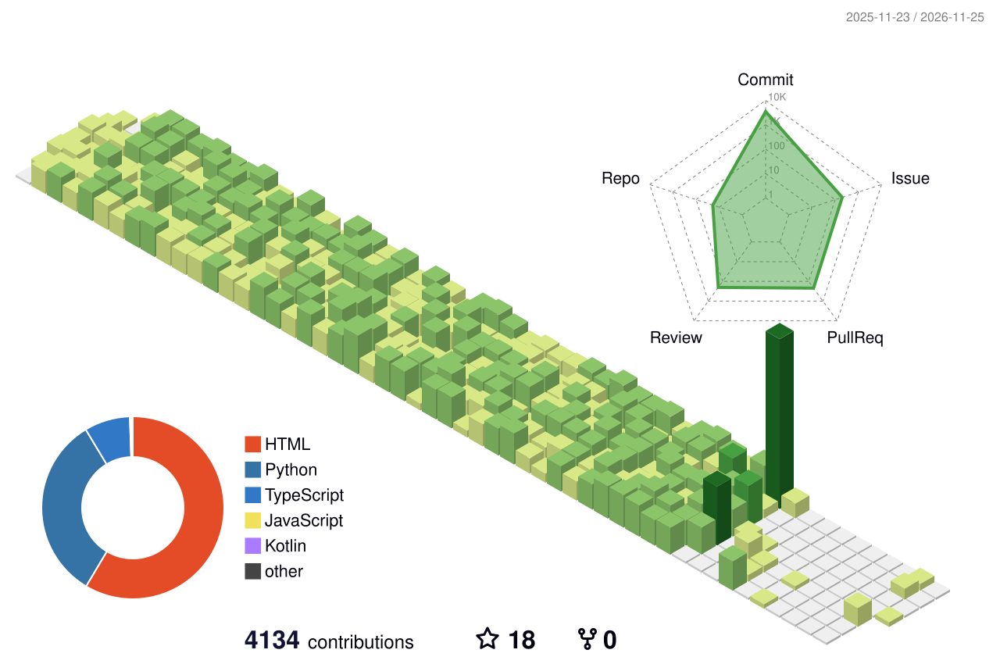

  <h1>lucifer5051</h1>
  
<strong>AI &amp; ML student building practical software, applied ML systems, and local-first AI tools.</strong>

  
Python · Agent systems · Computer vision · Real-time voice AI

  

    
    
    
  

## About

I'm a diploma student in Artificial Intelligence &amp; Machine Learning who enjoys turning technical ideas into working software. My public projects span Python engineering, applied machine learning, autonomous-agent architecture, computer vision, streaming voice systems, and full-stack applications.

I'm especially interested in local-first design, reliable automation, useful memory systems, and the engineering work that makes AI applications dependable beyond a demo.

## Profile signal

<picture>
  <source media="(prefers-color-scheme: dark)" srcset="./assets/profile-cards/overview.dark.svg">
  
</picture>

<picture>
  <source media="(prefers-color-scheme: dark)" srcset="./assets/profile-cards/languages.dark.svg">
  
</picture>

## Contribution city

<picture>
  <source media="(prefers-color-scheme: dark)" srcset="./profile-3d-contrib/profile-night-green.svg">
  
</picture>

## Featured work

<table>
  <tr>
    <td width="50%" valign="top">
      <h3><a href="https://github.com/lucifer5051/AEGIS">AEGIS · SAGE</a></h3>
      
A local-first personal agent and AI workstation focused on digital-life orchestration, modular skills, structured memory, adaptive configuration, and deterministic security boundaries.

      

        
        
        
      

    </td>
    <td width="50%" valign="top">
      <h3><a href="https://github.com/lucifer5051/Aether">Project Aether</a></h3>
      
Independent research into low-latency, full-duplex voice AI: streaming speech, interruption handling, acoustic echo cancellation, and hardware-aware inference on consumer hardware.

      

        
        
        
      

    </td>
  </tr>
  <tr>
    <td width="50%" valign="top">
      <h3><a href="https://github.com/lucifer5051/CIVIS-CORE">CIVIS-CORE</a></h3>
      
A modular multi-camera computer-vision platform with video ingestion, object detection, and an operator-facing API/dashboard, designed to extend into tracking and event intelligence.

      

        
        
        
      

    </td>
    <td width="50%" valign="top">
      <h3><a href="https://github.com/lucifer5051/hybrid-fraud-detector-services">Hybrid Fraud Detector</a></h3>
      
A modular fraud-detection ML pipeline combining XGBoost and Isolation Forest, with automated model training and evaluation.

      

        
        
        
      

    </td>
  </tr>
</table>

## More experiments

- [EventHorizon Black Hole Simulation](https://github.com/lucifer5051/EventHorizon-BlackHole-Sim) · GPU-accelerated Schwarzschild black-hole and accretion-disk simulation.
- [QRTunnel](https://github.com/lucifer5051/QRTunnel) · High-speed optical file transfer using multi-QR packet streaming.
- [HealthOS](https://github.com/lucifer5051/HealthOS) · Offline-first personal health and activity application.
- [Looking At Something clone](https://github.com/lucifer5051/lookingatsomething-clone) · Interactive mouse-tracking visual experience.
- [Spice Garden](https://github.com/lucifer5051/spice-garden-full-stack) · Full-stack restaurant web application built during internship work.
- [Student Management System](https://github.com/lucifer5051/Student_Management_System) · Django, MySQL, and Bootstrap CRUD application.

## Technologies across my projects

**Languages:** Python, JavaScript, Kotlin, TypeScript, HTML/CSS  
**AI / ML:** PyTorch, Transformers, scikit-learn, XGBoost, Isolation Forest, OpenCV, Ultralytics YOLO  
**Application development:** FastAPI, Django, Flask, React, Node.js, Express, SQLite, MySQL, MongoDB

## Profile automation

The statistics cards and 3D contribution calendar are generated in this repository by GitHub Actions. They refresh daily (scheduled around midnight India time) and can also be rebuilt manually from the **Actions** tab. Repository star and last-commit badges are live Shields.io endpoints, so their values update independently of the README text.

[View profile refresh workflow](https://github.com/lucifer5051/lucifer5051/actions/workflows/profile-refresh.yml)
